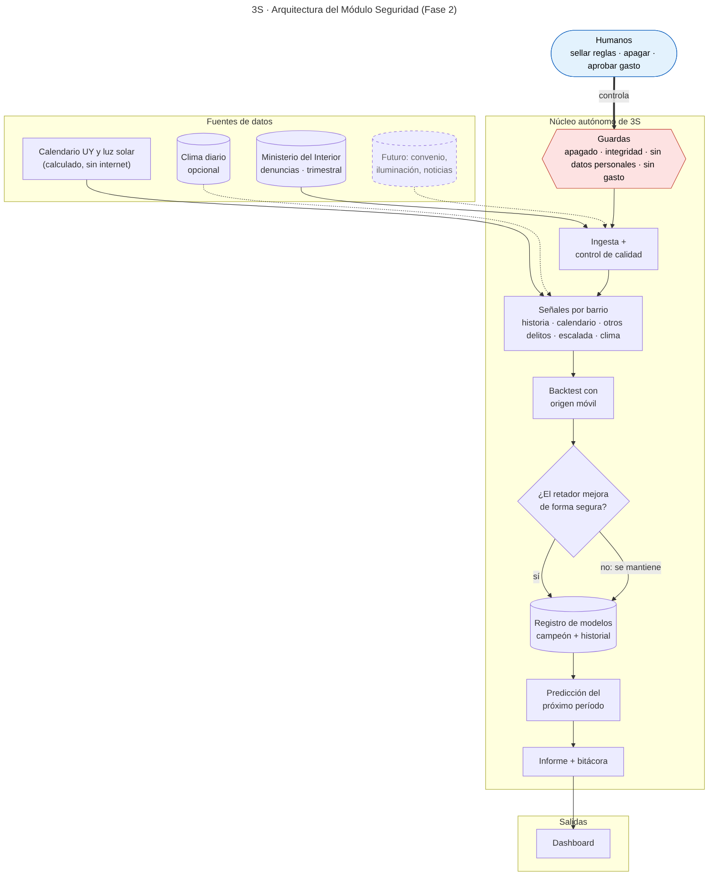
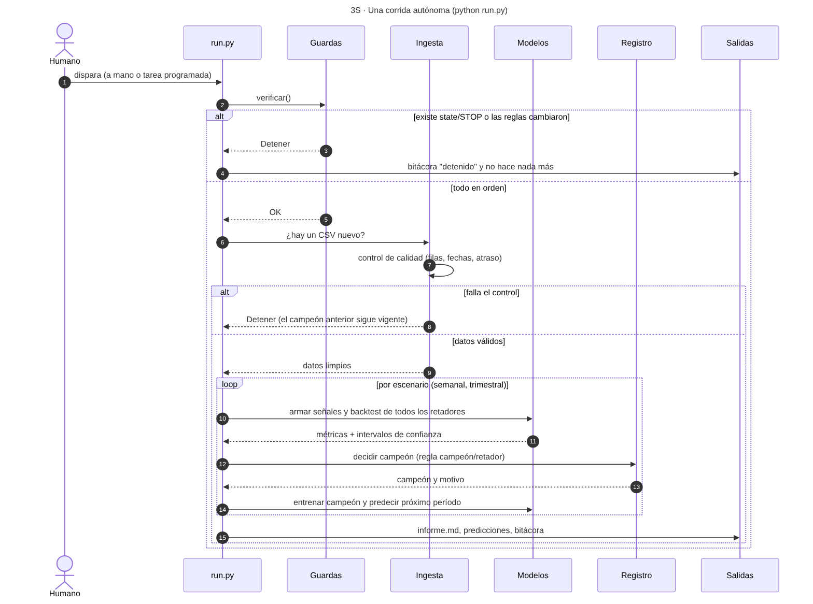
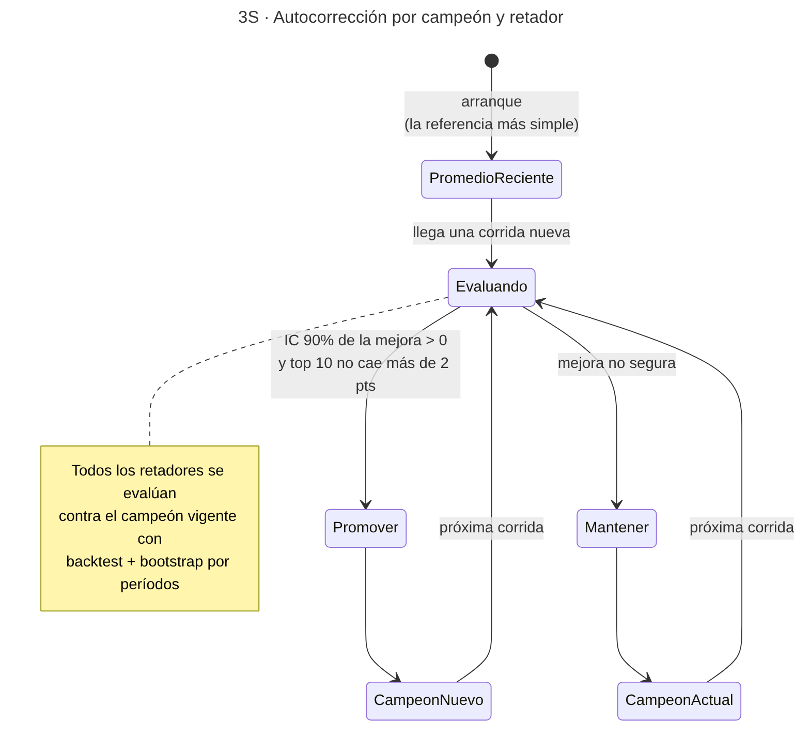
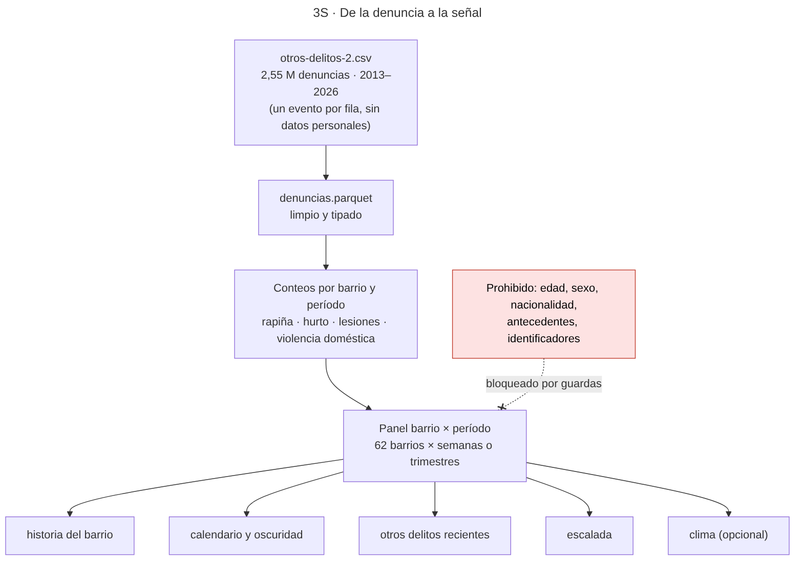
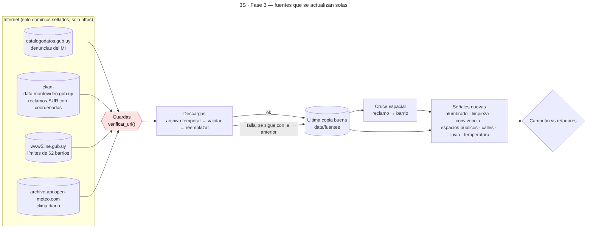
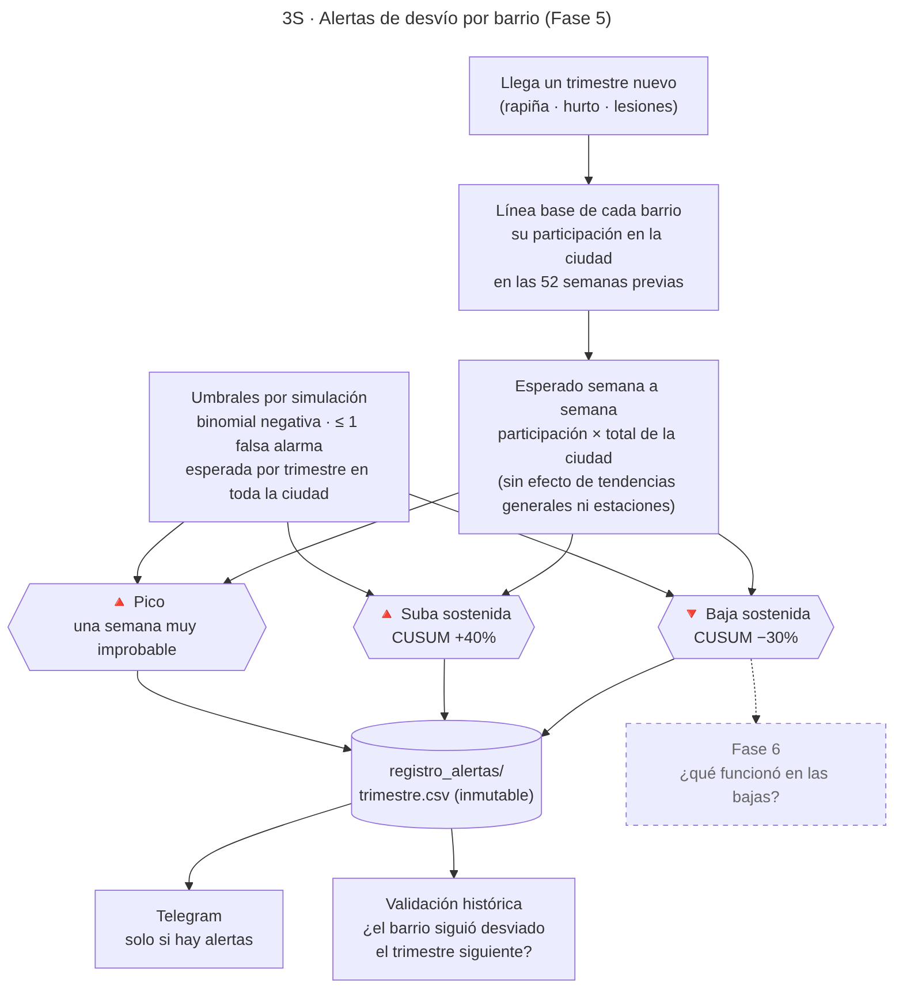
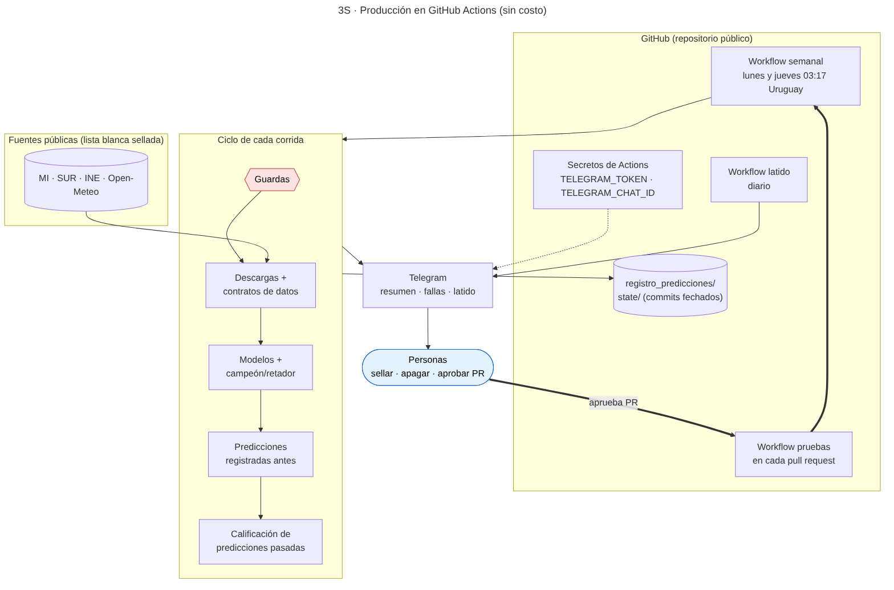
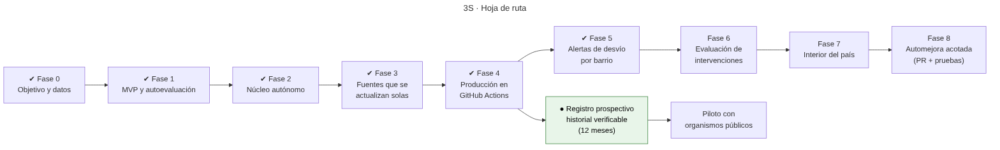

# Arquitectura

## Visión general

## Módulos (`src/s3/`)
| Módulo | Qué hace |
|---|---|
| `guardas.py` | **Sellado.** Interruptor de apagado, verificación de integridad de las reglas, lista blanca de dominios y bloqueo de campos personales |
| `descargas.py` | Baja las fuentes vencidas a un archivo temporal, las valida y recién entonces reemplaza la copia anterior |
| `contratos.py` | Qué columnas y volumen espera de cada fuente, con sinónimos para adaptarse a cambios conocidos |
| `ingest.py` | Lee y limpia las denuncias del Ministerio del Interior |
| `territorio.py` | Ubica cada reclamo de la Intendencia en su barrio (cruce espacial con los límites del INE) |
| `calendario_uy.py` | Feriados de Uruguay (Carnaval y Turismo calculados a partir de la Pascua), semanas de cobro y horas de luz |
| `features.py` | Arma el panel barrio × período y los conjuntos de señales que compiten |
| `modelo.py` | Backtest con origen móvil, métricas, bootstrap y piso del azar |
| `registro.py` | Campeón y retador: decide si un modelo nuevo reemplaza al vigente |
| `prospectivo.py` | Registra predicciones a ciegas y las califica cuando llegan los datos |
| `alertas.py` | Alertas de desvío: línea base por barrio, CUSUM de subas y bajas, picos, umbrales calibrados por simulación y validación histórica |
| `registro_alertas.py` | Registro público e inmutable de alertas por trimestre, mensaje de Telegram y sección del informe |
| `avisos.py` | Telegram y latido |
| `orquestador.py` | Une todo en una corrida |

## Una corrida

## Autocorrección

Cada corrida evalúa a todos los retadores contra el campeón vigente. Para reemplazarlo, la mejora tiene que ser segura: el intervalo de confianza del 90% (bootstrap por períodos) tiene que estar por encima de cero, y el acierto en el top 10 no puede caer más de 2 puntos. Si ninguno lo logra, se mantiene lo que ya funcionaba.

## Datos

## Alertas de desvío

## Producción

## Hoja de ruta

Los diagramas se editan en los archivos `.mmd` (Mermaid). GitHub, VS Code y Obsidian los muestran directamente.
